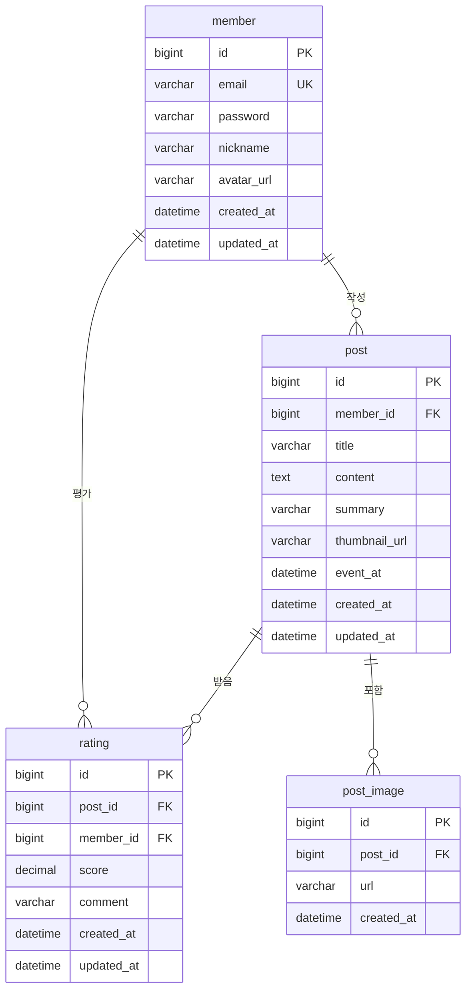

# FRIENDLOG ERD (MySQL)

> 0단계 설계. 인증(2단계)·평균 평점(3단계)·이미지 정리(4단계)에서 테이블이 추가·변경될 수 있다.
> 서버 코드는 같은 레포의 `server/` 에 있다.

## 다이어그램

## 테이블

### member

| 컬럼 | 타입 | 제약 | 설명 |
| --- | --- | --- | --- |
| id | BIGINT | PK, AUTO_INCREMENT | |
| email | VARCHAR(255) | NOT NULL, UNIQUE | 로그인 ID |
| password | VARCHAR(255) | NOT NULL | bcrypt 해시 (평문 저장 금지) |
| nickname | VARCHAR(30) | NOT NULL | |
| avatar_url | VARCHAR(500) | NULL | 없으면 기본 아이콘 |
| created_at | DATETIME(6) | NOT NULL | |
| updated_at | DATETIME(6) | NOT NULL | |

### post

| 컬럼 | 타입 | 제약 | 설명 |
| --- | --- | --- | --- |
| id | BIGINT | PK, AUTO_INCREMENT | |
| member_id | BIGINT | NOT NULL, FK → member.id | 작성자 (기존: email) |
| title | VARCHAR(100) | NOT NULL | |
| content | TEXT | NOT NULL | 마크다운 본문 (최대 64KB) |
| summary | VARCHAR(500) | NULL | 카드에 보이는 요약 |
| thumbnail_url | VARCHAR(500) | NULL | 없으면 기본 썸네일 |
| event_at | DATETIME | NOT NULL | 모임 날짜+시간 (기존: event_date + 본문의 "### 시간:") |
| created_at | DATETIME(6) | NOT NULL | |
| updated_at | DATETIME(6) | NOT NULL | |

인덱스: `(event_at)` — 최신순·오래된순 정렬과 무한 스크롤.

### rating

| 컬럼 | 타입 | 제약 | 설명 |
| --- | --- | --- | --- |
| id | BIGINT | PK, AUTO_INCREMENT | |
| post_id | BIGINT | NOT NULL, FK → post.id | |
| member_id | BIGINT | NOT NULL, FK → member.id | 평가한 사람 |
| score | DECIMAL(2,1) | NOT NULL, CHECK 0.5~5.0 | 0.5 단위는 서버에서 검증 |
| comment | VARCHAR(500) | NULL | 한줄평 |
| created_at | DATETIME(6) | NOT NULL | |
| updated_at | DATETIME(6) | NOT NULL | 평가 수정 시각 |

유니크: `(post_id, member_id)` — 한 사람이 글 하나에 평가 하나. 다시 평가하면 수정.
이 유니크 인덱스가 `post_id` 로 시작해서 "이 글의 평가 목록" 조회에도 쓰인다.

### post_image

| 컬럼 | 타입 | 제약 | 설명 |
| --- | --- | --- | --- |
| id | BIGINT | PK, AUTO_INCREMENT | |
| post_id | BIGINT | NOT NULL, FK → post.id | |
| url | VARCHAR(500) | NOT NULL | 본문에 들어간 이미지 |
| created_at | DATETIME(6) | NOT NULL | |

### signup_verification (2단계, V2)

인증 코드 확인 전의 가입 정보. 코드가 맞으면 member를 만들고 이 행은 지운다.

| 컬럼 | 타입 | 설명 |
| --- | --- | --- |
| email | VARCHAR(255) UNIQUE | |
| password | VARCHAR(255) | bcrypt 해시 |
| nickname | VARCHAR(30) | |
| code | CHAR(6) | 인증 코드 |
| expires_at | DATETIME(6) | 발급 후 10분 |
| failed_attempts | INT | 5번 틀리면 재발급 필요 |
| last_sent_at | DATETIME(6) | 재전송 60초 제한 |

### refresh_token (2단계, V2)

| 컬럼 | 타입 | 설명 |
| --- | --- | --- |
| member_id | BIGINT FK | |
| token_hash | CHAR(64) UNIQUE | 원문이 아닌 SHA-256 해시 |
| expires_at | DATETIME(6) | 발급 후 14일 |

### uploaded_image (4단계, V3)

Presigned URL 발급 기록. 정리 스케줄러가 쓰이지 않는 파일을 찾는 데 쓴다.

| 컬럼 | 타입 | 설명 |
| --- | --- | --- |
| member_id | BIGINT | 발급받은 회원 (FK 없음: 기록용) |
| object_key | VARCHAR(300) UNIQUE | S3 키 (`thumbnail/{uuid}.webp`) |
| url | VARCHAR(500) | 공개 주소 |
| created_at | DATETIME(6) | 이 시각 + 24시간이 지나야 정리 대상 |

## 결정과 이유

| 결정 | 이유 |
| --- | --- |
| PK는 BIGINT 자동 증가 | MySQL·JPA에서 가장 흔하고, 인덱스가 작고 삽입이 빠름. 기존 uuid는 7단계에서 대응표로 변환 |
| 작성자를 email → `member_id` 로 연결 | email이 바뀌어도 연결이 유지됨. 조인으로 닉네임·아바타를 한 번에 가져옴 (카드마다 프로필 요청하던 문제 해결) |
| `ratings.nickname` 삭제 | profiles와 중복. 닉네임을 바꾸면 값이 어긋남. member와 조인 |
| 본문 이미지를 `post_image` 테이블로 분리 | JSON 문자열은 DB가 검색할 수 없음. 4단계의 쓰지 않는 이미지 정리에 필요 |
| 별점은 DECIMAL(2,1) | 4.5를 그대로 저장, 소수 오차 없음 |
| 모임 시간을 `event_at` 컬럼으로 | 본문 텍스트를 정규식으로 읽던 카운트다운을 컬럼으로. 본문 형식이 바뀌어도 안 깨짐 |
| `(post_id, member_id)` 유니크 | "1인 1평가"를 코드가 아니라 DB가 보장 |
| 평균 평점 컬럼 없음 (보류) | 저장할지 매번 계산할지 3단계에서 결정 |

## 공통 규칙

- 문자셋 `utf8mb4` — 이모지 저장. MySQL의 `utf8` 은 3바이트라 이모지가 깨진다
- 시간은 한국 시간(KST) 기준 DATETIME으로 저장. Supabase의 timestamptz(UTC)는 이전할 때 변환
- `created_at`, `updated_at` 은 JPA Auditing으로 자동 기록 (1단계)

## 나중에 정할 것

| 항목 | 단계 |
| --- | --- |
| ~~이메일 인증 코드·리프레시 토큰 저장~~ → 둘 다 MySQL 테이블 (Redis 없이 운영 단순화) | 2단계 완료 |
| ~~평균 평점 저장 여부~~ → 저장하지 않고 매번 계산 | 1단계에서 결정 |
| ~~쓰이지 않은 이미지 추적~~ → 발급 기록 테이블 + 썸네일·본문·아바타 참조 여부로 판단 | 4단계 완료 |
| ~~글 삭제 시 평가·이미지~~ → 평가는 서비스에서 벌크 DELETE, 이미지는 JPA cascade | 1단계 완료 |
| 컬럼 길이(title 100, nickname 30 등)가 기존 데이터에 맞는지 | 7단계 이전 전 확인 |

## Supabase → MySQL 대응 (7단계 참고)

| Supabase | MySQL | 변환 |
| --- | --- | --- |
| `auth.users` + `profiles` | `member` | uuid → 새 id 대응표 생성. 비밀번호 해시 이전 가능 여부 확인 |
| `posts.email` | `post.member_id` | email로 member를 찾아 id로 |
| `posts.event_date` + 본문 "### 시간:" | `post.event_at` | 본문에서 시간 추출, 없으면 날짜만 (시간 기본값 정해야 함) |
| `posts.image_url` (JSON 문자열) | `post_image` 여러 줄 | JSON 파싱 |
| `posts.rating` | (없음) | 3단계 결정에 따라 |
| `posts.content_summary` | `post.summary` | |
| `ratings.user_id` (uuid) | `rating.member_id` | 대응표로 변환 |
| `ratings.rating` | `rating.score` | null인 평가 처리 방법 결정 |
| `ratings.nickname` | (삭제) | |
| 이미지 URL (Supabase Storage) | S3 URL | 4·7단계 |
